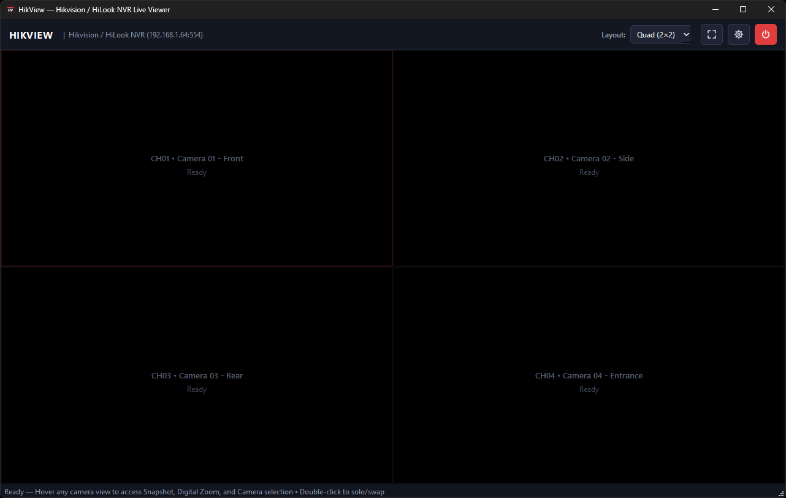
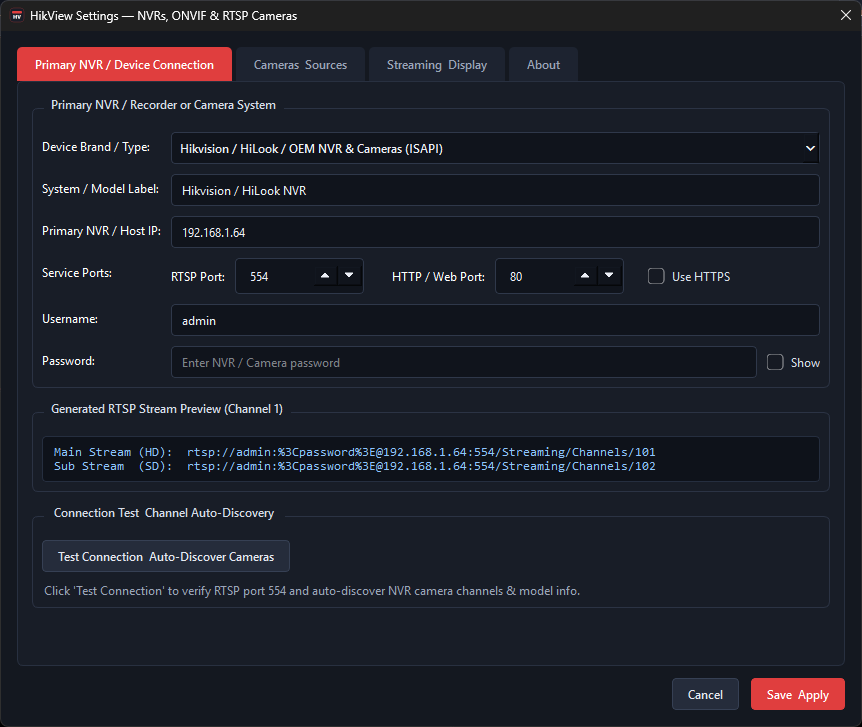
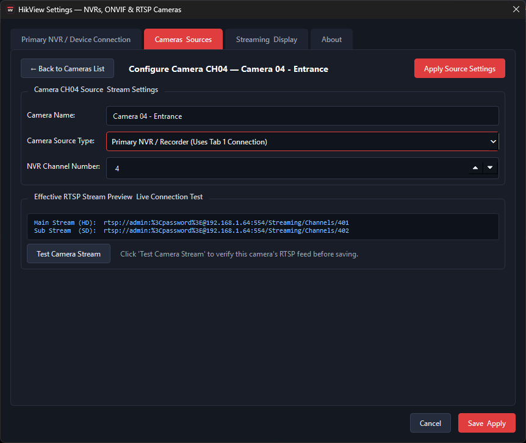
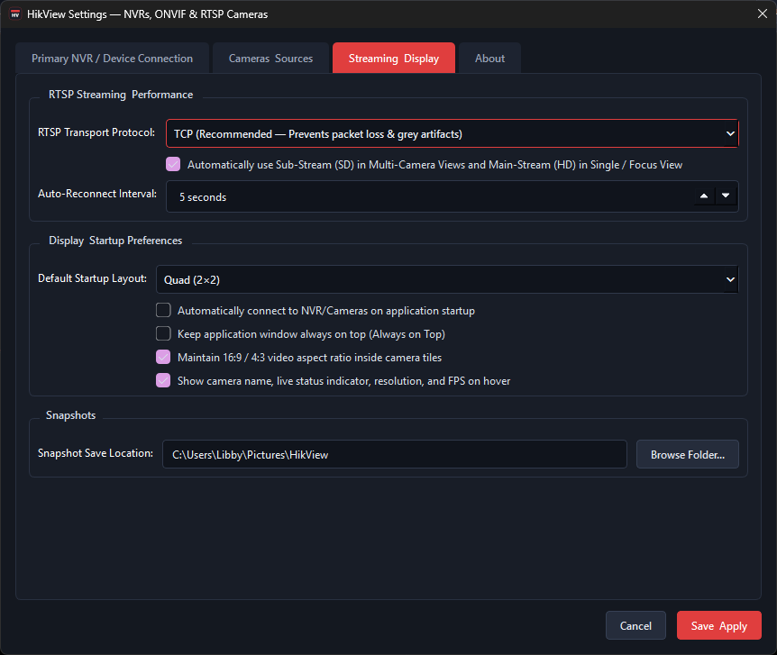

<div align="center">

# 📹 HikView

### Lightweight Windows Viewer for NVRs & RTSP/ONVIF IP Cameras

**A fast, streamlined, low-latency alternative to traditional CCTV viewing software.**

View and manage up to **16 cameras** from multiple NVRs and standalone IP cameras — all in one application.

[](https://github.com/LibbyLamarr/HikView/releases)


[](LICENSE)
[](https://github.com/LibbyLamarr/HikView/releases)

<br>

[**⬇ Download Latest Release**](https://github.com/LibbyLamarr/HikView/releases) · [**📸 Screenshots**](#-screenshots) · [**✨ Features**](#-key-features) · [**🚀 Quick Start**](#-quick-start-guide)

</div>

---

## 📖 Overview

**HikView** is a lightweight Windows desktop application designed for fast, responsive, low-latency live viewing of Network Video Recorders (NVRs) and standalone IP cameras.

Created as a light alternative to resource-heavy surveillance suites such as **Hikvision iVMS-4200**, HikView focuses on doing one thing well: providing a clean, reliable way to monitor your cameras without unnecessary complexity.

Whether you have a single IP camera, a Hikvision or HiLook recorder, or multiple NVRs from different manufacturers, HikView brings your camera feeds together in one easy-to-use interface.

### Why HikView?

- 🎥 **Up to 16 simultaneous camera feeds** in a single window.
- 🖥️ **Multiple viewing layouts**, from single-camera HD to 16-camera grids.
- 🔗 **Multi-brand compatibility** with popular NVRs and IP cameras.
- ⚡ **Low-latency streaming** powered by FFmpeg.
- 🔄 **Automatic HD/SD stream switching** to optimise performance.
- 🔍 **Camera auto-discovery** for supported NVRs.
- 🖱️ **Drag-and-drop camera arrangement** with convenient right-click controls.
- 📸 **Instant PNG snapshots** of live camera feeds.
- 📦 **Installer and portable versions** for Windows 10 and 11.

---

## 📸 Screenshots

A look at HikView's main interface, device configuration and streaming options.

### 🖥️ Main Camera Viewer

The main HikView interface provides a clean, responsive environment for monitoring multiple cameras simultaneously.

<div align="center">



*HikView — Main live camera viewing interface*

</div>

### ⚙️ NVR Connection & Setup

Configure your primary NVR, select the appropriate device preset and automatically discover available camera channels.

<div align="center">



*Primary NVR configuration and camera discovery*

</div>

### 📷 Additional Camera Configuration

Extend your camera setup by connecting a secondary NVR or adding standalone IP cameras to your existing configuration.

<div align="center">



*Additional NVR and standalone IP camera configuration*

</div>

### 🎞️ Streaming Options

Configure streaming behaviour and optimise the balance between image quality, performance and latency.

<div align="center">



*Streaming and performance configuration*

</div>

---

## ✨ Key Features

### 🎥 Multi-Brand NVR & IP Camera Support

HikView includes built-in RTSP connection presets for a wide range of popular surveillance equipment.

Supported device families include:

- **Hikvision / HiLook** — including NVR-104H-D/4P, NVR-108H/208M and DS-76xx/77xx series.
- **Legacy Hikvision** — support for older RTSP streaming paths.
- **Dahua / Amcrest / Lorex** — compatible RTSP and CGI connections.
- **Reolink** — NVRs and standalone IP cameras.
- **Uniview (UNV)** — compatible RTSP streams.
- **TP-Link Tapo / VIGI** — supported camera streaming paths.
- **Generic ONVIF / Custom RTSP** — manually configured main and sub-stream URLs.

Device compatibility depends on firmware, supported protocols and the availability of RTSP streams.  Note, development has only been tested on limited hardware - full compatibility not guaranteed!

### 🔍 Automatic NVR Discovery

For supported recorders, HikView can simplify initial setup by detecting device information and configured camera channels.

- Test NVR network connectivity.
- Identify supported recorder models.
- Retrieve camera channel names where available.
- Use ISAPI or CGI discovery methods.
- Populate camera configuration automatically.

HikView also handles URL encoding of special characters in camera and NVR passwords, including `@`, `:`, `#` and `/`.

### 🖥️ Flexible Camera Layouts

Choose a viewing arrangement that best suits your monitoring needs.

| Layout | Description |
|:---|:---|
| **1×1 Single View** | One camera displayed at maximum size |
| **2×2 Quad View** | Four simultaneous camera feeds |
| **3×3 Grid** | Nine simultaneous camera feeds |
| **4×4 Grid** | Sixteen simultaneous camera feeds |
| **1+3 Focus View** | One large primary camera with three smaller feeds |
| **1+5 Focus View** | One large primary camera with five smaller feeds |

**Additional layout controls:**

- Double-click a camera to maximise it.
- Double-click again to restore the previous layout.
- Drag and drop camera tiles to swap positions.
- Right-click a tile to assign a different camera.
- Set unused tiles to an empty black view.
- Switch between windowed and borderless fullscreen modes.

### ⚡ Intelligent HD / SD Stream Switching

HikView automatically selects the appropriate video stream based on the viewing layout.

| Viewing Mode | Preferred Stream | Benefit |
|:---|:---|:---|
| Multi-camera grids | Sub-Stream (SD) | Reduced CPU and network usage |
| Single-camera view | Main-Stream (HD) | Higher image quality |
| Primary focus camera | Main-Stream (HD) | Enhanced detail |
| Individual camera override | User selectable | Greater control |

This approach helps maintain responsive multi-camera viewing while preserving high-definition detail when needed (can override within settings).

### 🔄 Low-Latency Streaming Engine

HikView uses FFmpeg for efficient video decoding and real-time streaming.

Key capabilities include:

- Dedicated background decoding thread per camera.
- RTSP streaming over TCP.
- Low-buffer and low-delay decoding options.
- Automatic reconnection when a camera stream is interrupted.
- Independent stream handling for multiple camera sources.

The result is a responsive viewing experience without the overhead of a full surveillance management suite.

### 📸 Instant Camera Snapshots

Capture still images directly from a live camera feed.

- Save snapshots in PNG format.
- Use the `S` keyboard shortcut.
- Alternatively, right-click a camera and select **Save Snapshot**.
- Capture images from the selected camera without interrupting live viewing.

### 🔗 Multiple Camera Sources

HikView can combine feeds from different sources into one unified viewing layout.

Supported configurations include:

- **Primary NVR**
- **Secondary NVR**
- **Standalone IP Cameras**

Configure up to **16 camera channels** in total, mixing recorder channels and independent camera streams as required.

---

## 📡 Supported NVRs & IP Cameras

HikView provides predefined RTSP path formats for common camera manufacturers.

| Brand / Preset | Main Stream | Sub-Stream | Discovery / Connection |
|:---|:---|:---|:---|
| **Hikvision / HiLook / OEM** | `/Streaming/Channels/<Ch>01` | `/Streaming/Channels/<Ch>02` | ISAPI HTTP Digest |
| **Legacy Hikvision / HiLook** | `/h264/ch<Ch>/main/av_stream` | `/h264/ch<Ch>/sub/av_stream` | ISAPI / TCP |
| **Dahua / Amcrest / Lorex** | `/cam/realmonitor?channel=<Ch>&subtype=0` | `/cam/realmonitor?channel=<Ch>&subtype=1` | CGI HTTP Digest |
| **Reolink** | `/h264Preview_<Ch>_main` | `/h264Preview_<Ch>_sub` | TCP + RTSP Test |
| **Uniview (UNV)** | `/unicast/c<Ch>/s0/live` | `/unicast/c<Ch>/s1/live` | TCP + RTSP Test |
| **TP-Link Tapo / VIGI** | `/stream1` | `/stream2` | TCP + RTSP Test |
| **Custom RTSP / ONVIF** | User-defined RTSP URL | User-defined RTSP URL | TCP + RTSP Test |

> **Note:** RTSP path formats may vary by model, firmware and manufacturer. ONVIF-compatible devices can be configured using their available RTSP stream URLs. Automatic camera discovery is primarily available for supported ISAPI and CGI devices.

---

## ⬇️ Download & Installation

HikView is designed for **Windows 10 and Windows 11**.

Prebuilt releases are available in two formats, allowing you to choose between a conventional Windows installation and a portable application.

<div align="center">

### [⬇️ Download HikView v1.0.0](https://github.com/LibbyLamarr/HikView/releases)

</div>

### Option 1 — Windows Installer (Recommended)

Best for regular desktop use.

1. Visit the [GitHub Releases](https://github.com/LibbyLamarr/HikView/releases) page.
2. Download **`HikView-Setup-v1.0.0.exe`**.
3. Run the installer.
4. Follow the installation instructions.
5. Launch HikView using the Desktop or Start Menu shortcut.

The default installation directory is:

```text
C:\Program Files\HikView
```

### Option 2 — Portable ZIP

Ideal for users who prefer not to install additional software.

1. Download **`HikView-Portable-v1.0.0.zip`** from GitHub Releases.
2. Extract the ZIP archive to a folder of your choice.
3. Open the extracted `HikView` folder.
4. Run **`HikView.exe`**.

The portable version can also be stored on a USB drive or in a dedicated utilities folder.

### Option 3 — Run from Python Source

For developers or users who prefer to run the application directly from source.

Clone the repository:

```powershell
git clone https://github.com/LibbyLamarr/HikView.git
cd HikView
```

Install the required Python dependencies:

```powershell
pip install -r requirements.txt
```

Launch the application:

```powershell
python main.py
```

> **Note:** Running from source requires Python and the dependencies specified by the project. Prebuilt releases are the simplest option for most users.

---

## 🚀 Quick Start Guide

Getting started with HikView takes just a few steps.

### 1. Open Settings

Launch **HikView** and click **Settings** in the top toolbar.

### 2. Configure Your Primary NVR

Open the **Primary NVR / Device Connection** tab and enter your recorder's connection details.

| Setting | Example |
|:---|:---|
| Device Brand / Type | Hikvision / HiLook |
| NVR IP Address | `192.168.1.64` |
| RTSP Port | `554` |
| HTTP Port | `80` |
| Username | `admin` |
| Password | Your NVR password |

Use the actual network settings and credentials for your recorder.

### 3. Test & Discover Cameras

Click:

**Test Connection & Auto-Discover Cameras**

For supported NVRs, HikView will test connectivity and attempt to retrieve the recorder's camera channels.

### 4. Add Additional Cameras (Optional)

Open the **Cameras & Sources** tab.

From here you can:

- Configure channels from your primary NVR.
- Add cameras from a secondary NVR.
- Add standalone RTSP IP cameras.
- Configure individual camera sources.
- Build a combined layout of up to 16 cameras.

Use **Configure** on an individual camera row to customise its connection.

### 5. Save & Connect

Click **Save & Apply** to store your configuration.

Then select **Connect Live** to begin viewing your cameras.

### 6. Choose Your Preferred Layout

Switch between single-camera, quad, nine-camera, sixteen-camera and focus layouts.

Double-click any camera tile to maximise its feed, then double-click again to restore the previous layout.

---

## ⌨️ Keyboard Shortcuts & Mouse Controls

HikView includes convenient shortcuts for quickly navigating between camera feeds and viewing modes.

| Shortcut / Action | Function |
|:---|:---|
| **Double-click camera tile** | Toggle between single-camera and multi-camera view |
| **Drag & drop camera tile** | Swap camera positions |
| **`F11` / `F`** | Toggle borderless fullscreen mode |
| **`Esc`** | Exit fullscreen mode |
| **`1` – `9`** | Open Camera 1–9 in single-camera view |
| **`G`** | Switch to 2×2 quad view |
| **`S`** | Save PNG snapshot of the selected camera |
| **Right-click camera tile** | Open the camera context menu |

The right-click context menu provides access to additional functions including:

- Assign Camera
- Switch Layout
- Switch HD / SD
- Save Snapshot
- Reconnect Camera

---

## 🛠️ Building from Source

HikView includes batch scripts for building Windows executables and release packages.

### Build Standalone Windows Executable

Run:

```bat
build_exe.bat
```

The resulting executable is generated at:

```text
dist\HikView\HikView.exe
```

### Build Release Packages

Run:

```bat
build_release.bat
```

This produces the Windows installer and portable ZIP release packages:

```text
releases\
├── HikView-Setup-v1.0.0.exe
└── HikView-Portable-v1.0.0.zip
```

Build requirements and output may depend on the tools and dependencies configured in the project.

---

## 💡 Design Philosophy

HikView was created with a straightforward objective:

**Provide a practical, responsive and easy-to-use Windows camera viewer without the complexity of traditional CCTV management software.**

The application prioritises:

- **Simplicity** — clear controls and an uncluttered interface.
- **Performance** — efficient multi-camera viewing.
- **Compatibility** — support for multiple recorder and camera manufacturers.
- **Flexibility** — custom camera sources and adaptable viewing layouts.
- **Convenience** — quick camera switching, snapshots and fullscreen viewing.

HikView is intended primarily for **live camera monitoring**, rather than replacing a full-featured NVR recording and administration platform.

---

## 🔒 Security & Network Considerations

HikView connects to cameras and NVRs using the credentials and network settings you provide.

For safer operation:

- Use strong, unique passwords for cameras and recorders.
- Keep NVR and camera firmware updated.
- Prefer trusted local networks or a secure VPN for remote access.
- Avoid exposing RTSP or device management ports directly to the public internet.
- Use camera accounts with appropriate permissions where supported.

HikView is a viewing application and does not replace your existing NVR's recording or security functions.

---

## 🤝 Feedback & Contributions

Suggestions, bug reports and feature requests are welcome.

If you encounter an issue or have an idea for an improvement, please open an issue in the repository:

[**GitHub Issues — HikView**](https://github.com/LibbyLamarr/HikView/issues)

When reporting an issue, it is helpful to include:

- Windows version.
- NVR or camera manufacturer and model.
- Connection type or RTSP preset being used.
- A description of the problem and steps to reproduce it.

Please avoid including passwords, private credentials or sensitive camera footage in public issue reports.

---

## ⚖️ Disclaimer

HikView is an independent, third-party application and is **not affiliated with, endorsed by, sponsored by, or officially supported by Hikvision** or any other camera or NVR manufacturer.

All product names, trademarks and registered trademarks mentioned in this project remain the property of their respective owners. References to manufacturers and products are provided solely for identification and compatibility purposes.

---

## 📄 License & Credits

**HikView v1.0.0**

Developed and maintained by **[LibbyLamarr](https://github.com/LibbyLamarr)**.

Released under the **[MIT License](LICENSE)**.

Development of HikView has been supported by AI-assisted coding and development tools, with project direction, design decisions and testing guided by the developer.

---

<div align="center">

### 📹 HikView

**Simple. Lightweight. Flexible Camera Viewing.**

[**Download**](https://github.com/LibbyLamarr/HikView/releases) · [**Report an Issue**](https://github.com/LibbyLamarr/HikView/issues) · [**View Repository**](https://github.com/LibbyLamarr/HikView)

**Made for Windows 10 & 11**

</div>
